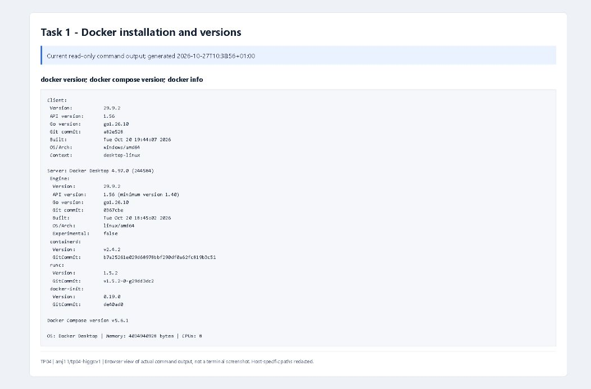
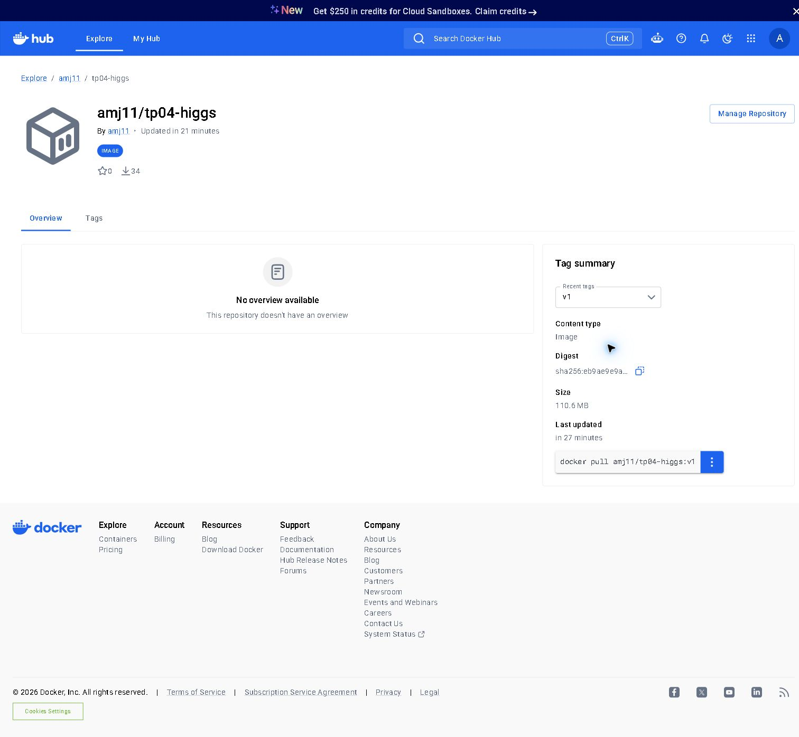
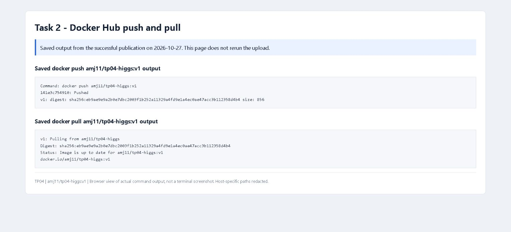
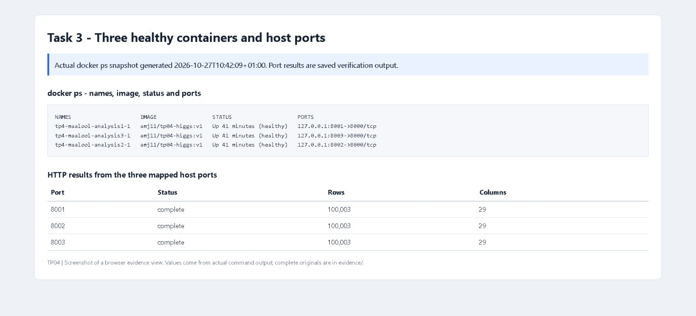
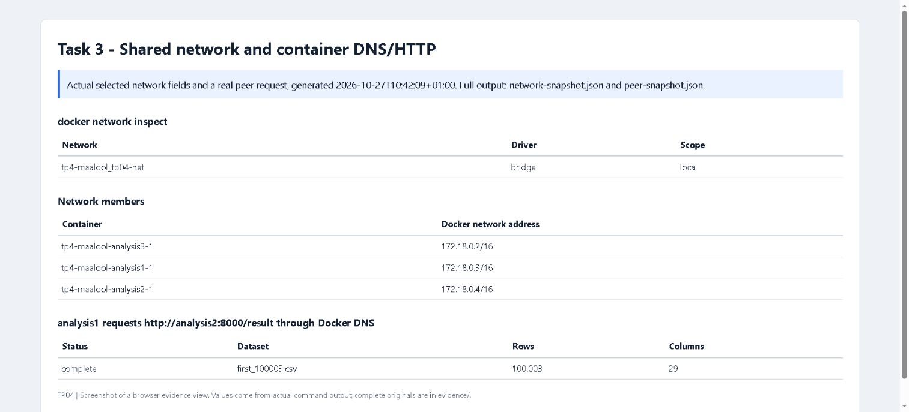
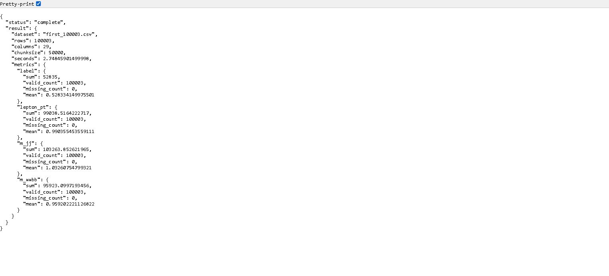
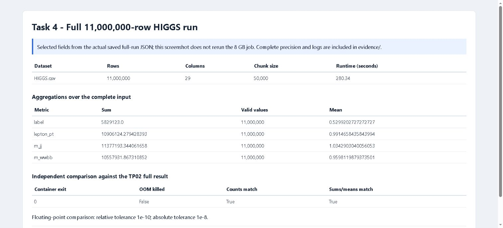
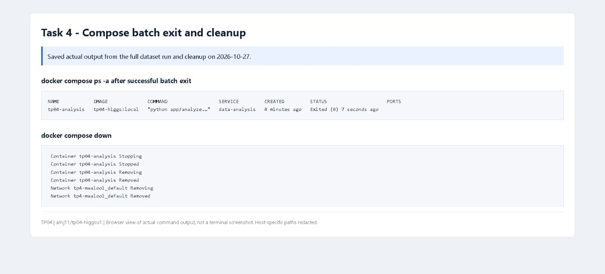

# Screenshot evidence - completed 2026-10-27

Eight genuine browser screenshots were captured through the Edge extension.
Images 02 and 06 show the live Docker Hub page and live container HTTP result.
The other images show clearly labelled browser views of actual command output:
current version/container/network snapshots or saved successful run/registry logs.
They are not terminal or native Docker Desktop screenshots. No screenshot pixels
or result values were edited. Raw logs and JSON remain in ../evidence/.

## Docker and Compose installation versions

Source: http://127.0.0.1:8765/01-installation-versions.html

## Published Docker Hub image and v1 tag

Source: https://hub.docker.com/r/amj11/tp04-higgs

## Successful registry push and subsequent pull

Source: http://127.0.0.1:8765/03-registry-push-pull.html

## Three healthy containers and host port checks

Source: http://127.0.0.1:8765/04-three-containers.html

## Shared bridge network and peer DNS/HTTP request

Source: http://127.0.0.1:8765/05-network-connectivity.html

## Completed live sample analysis result

Source: http://localhost:8001/result

## Complete 11,000,000-row run and validation

Source: http://127.0.0.1:8765/07-full-dataset-result.html

## Compose batch exit code 0 and cleanup

Source: http://127.0.0.1:8765/08-compose-lifecycle.html

## Provenance and reproduction

File hashes, dimensions and capture source types are in ../evidence/capture-manifest.json.
The HTML viewer sources are in ../evidence/views/. Their inputs are the original
evidence files and read-only Docker queries. scripts/build-evidence-views.py
can regenerate these views while the three-service project is running.

The image publication digest is unchanged:
sha256:eb9ae9e9a2b0e7dbc2003f1b252a11329a4fd9e1a4ec0ae47acc3b112358d4b4.
